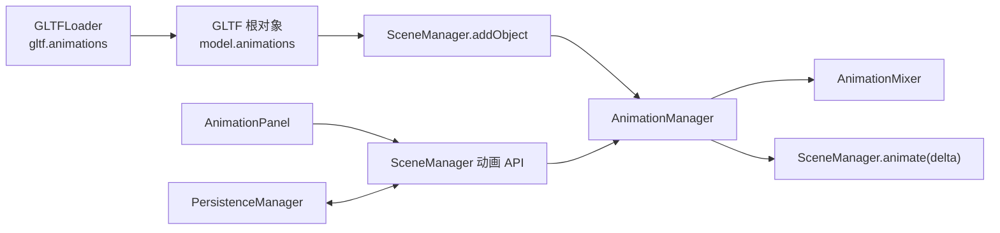

建议采用“Core 统一管理动画，编辑器面板只调用 API”的架构，不要让 `AnimationPanel.vue` 自己创建和维护 `AnimationMixer`。



## 一、先修复动画数据入口

当前 `loadGLTFModel()` 丢弃了 `gltf.animations`，首先需要在缓存前保存：

```js
const model = gltf.scene;

model.animations = gltf.animations?.slice() || [];
model.userData.modelType = 'GLTF';
model.userData.modelUrl = url;

this.normalizeAssetNodeIds(model, url);
this.modelCache.set(url, model);
```

后续：

```js
const instance = SkeletonUtils.clone(model);
```

会把根对象的 `animations` 数组复制给实例。

不要把完整 `AnimationClip` 写进 MongoDB。Clip 始终从 GLB 资源重新加载。

## 二、Core 新增 AnimationManager

建议增加：

```text
packages/core/src/AnimationManager.js
```

它负责：

- 查找模型可用的 AnimationClip。
- 为模型实例创建 `THREE.AnimationMixer`。
- 管理当前选中的 Clip。
- 播放、暂停和切换动画。
- 设置播放速度。
- 在渲染循环中调用 `mixer.update(delta)`。
- 对象删除、场景切换和 SDK 销毁时释放 Mixer。

内部结构建议：

```js
class AnimationManager {
  constructor() {
    this.controllers = new Map();
  }
}
```

Map 的键必须使用模型根 BID：

```js
Map<rootBid, {
  root,
  mixer,
  clips,
  action,
  state
}>
```

状态结构：

```js
{
  enabled: false,
  clipIndex: 0,
  clipName: 'Walk',
  speed: 1,
  loop: 'repeat'
}
```

不要把 `AnimationMixer`、`AnimationAction` 放进：

- Pinia
- `userData`
- MongoDB
- Vue 响应式对象

这些都是运行时对象，只能由 `AnimationManager` 持有。

## 三、Manager 的核心接口

建议实现以下接口：

```js
class AnimationManager {
  registerObject(root, initialState = {})
  unregisterObject(rootBid)

  getAnimations(rootBid)
  getAnimationState(rootBid)

  setAnimationClip(rootBid, clipSelector)
  setAnimationEnabled(rootBid, enabled)
  setAnimationSpeed(rootBid, speed)

  update(delta)
  dispose()
}
```

### `registerObject()`

对象加入场景时执行：

```js
registerObject(root, initialState = {}) {
  const clips = root.animations || [];
  if (clips.length === 0) return false;

  const rootBid = root.userData.bid;

  this.controllers.set(rootBid, {
    root,
    clips,
    mixer: null,
    action: null,
    state: {
      enabled: initialState.enabled ?? false,
      clipIndex: initialState.clipIndex ?? 0,
      clipName: initialState.clipName ?? clips[0]?.name ?? '',
      speed: initialState.speed ?? 1,
      loop: initialState.loop ?? 'repeat'
    }
  });

  return true;
}
```

Mixer 可以延迟到第一次启用动画时才创建，避免静态模型占用运行资源。

### `setAnimationEnabled()`

```js
setAnimationEnabled(rootBid, enabled) {
  const controller = this.controllers.get(rootBid);
  if (!controller) return false;

  if (enabled) {
    const action = this.ensureAction(controller);
    action.paused = false;
    action.play();
  } else if (controller.action) {
    controller.action.paused = true;
  }

  controller.state.enabled = enabled;
  return true;
}
```

建议开关语义定义为：

- 开启：播放或继续播放。
- 关闭：暂停在当前位置。
- 切换动画：新动画从头开始。

如果需要“停止并回到第一帧”，后续单独增加 `stopAnimation()`，不要让一个开关同时表达暂停和停止。

### `setAnimationSpeed()`

```js
setAnimationSpeed(rootBid, speed) {
  const controller = this.controllers.get(rootBid);
  if (!controller) return false;

  controller.state.speed = speed;

  if (controller.action) {
    controller.action.timeScale = speed;
  }

  return true;
}
```

建议第一版速度范围：

```text
0.1～3.0
```

### `setAnimationClip()`

```js
setAnimationClip(rootBid, { index, name }) {
  const controller = this.controllers.get(rootBid);
  if (!controller) return false;

  const clip = resolveClip(controller.clips, { index, name });
  if (!clip) return false;

  controller.action?.stop();

  controller.state.clipIndex = controller.clips.indexOf(clip);
  controller.state.clipName = clip.name;
  controller.action = controller.mixer?.clipAction(clip) || null;

  if (controller.state.enabled) {
    this.ensureAction(controller).reset().play();
  }

  return true;
}
```

## 四、动画标识不要只使用名称

AnimationClip 名称可能：

- 为空
- 重复
- 在资源重新处理后发生变化

面板查询结果建议返回：

```js
[
  {
    index: 0,
    name: 'Walk',
    label: 'Walk',
    duration: 2.35
  },
  {
    index: 1,
    name: '',
    label: '动画 2',
    duration: 1.8
  }
]
```

运行时使用 `index` 定位，持久化时同时保存：

```js
{
  clipIndex: 0,
  clipName: 'Walk'
}
```

恢复时：

1. 优先按 `clipName` 查找。
2. 名称为空、重复或找不到时，回退到 `clipIndex`。
3. 两者都无效时，回退到第一个 Clip。

## 五、支持选中模型内部节点

编辑器可能选中的是 GLTF 内部 Mesh，而动画挂在模型根节点。

因此公开 API 不应要求面板自己向上查找。由 Core 统一解析：

```js
resolveAnimationRoot(object) {
  let current = object;

  while (current) {
    if (
      current.userData?.modelType === 'GLTF' &&
      Array.isArray(current.animations)
    ) {
      return current;
    }

    current = current.parent;
  }

  return null;
}
```

面板可以传当前选中节点 BID：

```js
sceneManager.getAnimations(selectedObjectBid);
```

Core 返回：

```js
{
  rootBid: 'bid_xxx',
  animations: [...]
}
```

后续所有控制实际作用于 `rootBid`。

## 六、接入 SceneManager

构造阶段：

```js
this.animationManager = new AnimationManager();
```

渲染循环中：

```js
animate(time) {
  // ...
  const delta = (time - this.lastTime) / 1000;

  this.animationManager.update(delta);

  // renderer.render(...)
}
```

只更新已启用动画的 Mixer：

```js
update(delta) {
  for (const controller of this.controllers.values()) {
    if (
      controller.state.enabled &&
      controller.mixer
    ) {
      controller.mixer.update(delta);
    }
  }
}
```

对象加入时：

```js
addObject(object) {
  // BID 注册、scene.add 等现有逻辑
  this.animationManager.registerObject(
    object,
    object.userData.animationConfig
  );
}
```

对象删除时：

```js
removeObject(object) {
  this.animationManager.unregisterObject(object.userData.bid);

  // BVH、BID 和场景删除等现有逻辑
}
```

SceneManager 销毁时：

```js
this.animationManager.dispose();
```

## 七、SceneManager 公开门面

面板只调用以下方法：

```js
getAnimations(bid)
getAnimationState(bid)

setAnimationClip(bid, {
  index,
  name
})

setAnimationSpeed(bid, speed)
setAnimationEnabled(bid, enabled)
```

例如：

```js
getAnimations(bid) {
  const object = this.findObjectByBid(bid);
  const root = this.animationManager.resolveAnimationRoot(object);

  if (!root) return [];

  return this.animationManager.getAnimations(root.userData.bid);
}
```

如果未来第三方 SDK 也要控制动画，再将这些方法加入 `createMeteor3DInstance()`：

```js
getAnimations: bid =>
  sceneManager.getAnimations(bid),

setAnimationEnabled: (bid, enabled) =>
  sceneManager.setAnimationEnabled(bid, enabled),

setAnimationSpeed: (bid, speed) =>
  sceneManager.setAnimationSpeed(bid, speed),

setAnimationClip: (bid, options) =>
  sceneManager.setAnimationClip(bid, options)
```

## 八、动画面板改造

当前 [AnimationPanel.vue](F:/chenwei/Projects/Meteor3D/packages/scene-editor/src/components/AnimationPanel.vue) 直接读取：

```js
object.animations
```

后续应改为读取 Core API：

```js
const loadAnimationState = () => {
  const bid = selectedObject.value?.userData?.bid;

  if (!bid) {
    animations.value = [];
    return;
  }

  animations.value =
    sceneManager.getAnimations(bid);

  animationState.value =
    sceneManager.getAnimationState(bid);
};
```

UI 事件：

```js
const onClipChange = () => {
  sceneManager.setAnimationClip(selectedBid.value, {
    index: selectedClip.value.index,
    name: selectedClip.value.name
  });
};

const onSpeedChange = () => {
  sceneManager.setAnimationSpeed(
    selectedBid.value,
    playbackSpeed.value
  );
};

const onEnabledChange = () => {
  sceneManager.setAnimationEnabled(
    selectedBid.value,
    animationEnabled.value
  );
};
```

面板本身不负责每帧更新，不持有 Mixer。

## 九、场景持久化

动画设置属于具体 `SceneObject` 实例，不属于 Asset。

在 GLTF 序列化结果中增加：

```js
{
  type: 'GLTFModel',
  bid,
  url,
  position,
  rotation,
  scale,

  animation: {
    enabled: true,
    clipIndex: 0,
    clipName: 'Walk',
    speed: 1,
    loop: 'repeat'
  }
}
```

不建议保存当前播放时间。重新加载场景后默认从动画起点开始，行为更稳定。

`serializeObject()`：

```js
animation: this.sceneManager.getAnimationState(
  object.userData.bid
)
```

`deserializeObject()` 加载模型后先暂存：

```js
model.userData.animationConfig =
  data.animation || null;
```

然后 `SceneManager.addObject()` 注册动画时读取该配置。

后端 `SceneObject` 的 Mongoose Schema 也需要增加对应字段，否则严格 Schema 可能丢弃数据。

## 十、事件设计

建议增加：

```text
animation-state-changed
```

载荷：

```js
{
  bid,
  rootBid,
  state: {
    enabled,
    clipIndex,
    clipName,
    speed,
    loop
  }
}
```

用途：

- 场景树切换选择时刷新面板。
- App Editor 同步动画组件。
- AI Scene 查询当前状态。
- 多个 UI 同时控制同一对象时保持一致。

不要每帧发送播放进度事件。需要时间轴时再增加经过节流的独立事件。

## 十一、资源释放

注销模型时必须执行：

```js
controller.action?.stop();
controller.mixer?.stopAllAction();
controller.mixer?.uncacheRoot(controller.root);
```

然后删除 Map：

```js
this.controllers.delete(rootBid);
```

否则重复加载、删除模型后会残留：

- Mixer
- AnimationAction
- 对模型节点的绑定
- 内部 PropertyMixer 缓存

## 十二、推荐实施顺序

1. 在 `loadGLTFModel()` 中保留 `gltf.animations`。
2. 新增 `AnimationManager`。
3. 接入 `SceneManager.animate/addObject/removeObject/dispose`。
4. 增加 SceneManager 动画门面 API。
5. 将动画面板从本地状态改为调用 Core API。
6. 增加动画配置序列化和恢复。
7. 更新后端 `SceneObject` Schema。
8. 将动画接口加入 SDK 实例。
9. 验证普通 Mesh、骨骼动画、Morph 动画、多实例和删除重载。

第一阶段可以先完成 1～5，实现编辑器内播放控制；第二阶段再做持久化和 SDK 对外开放。